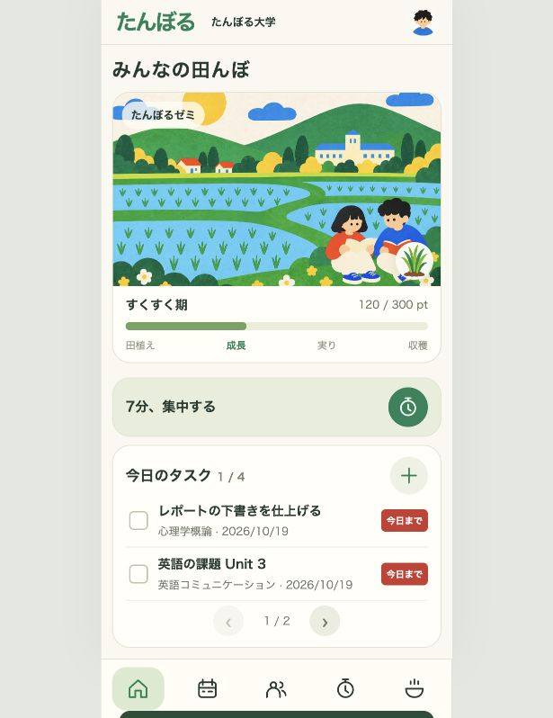

# たんぼる

一緒にがんばって、みんなで実らせる。



<!-- デモ動画ができたら、上の画像を動画リンク付きの画像に差し替える -->

公開先（Firebase Hosting、デプロイ後）：https://tanboru-2da31.web.app

旧公開先（Vercel）：https://tanboru.vercel.app

## 製品概要
### 背景(製品開発のきっかけ、課題等）
やるべきことも、人とのつながりも、一人では踏み出しにくい。大学新入生には、次の3つの壁があります。

1. **一人だと、後回し**：課題に取りかかれず、ついスマホを見てしまう。
2. **一緒にやりたくても、誘いにくい**：誰かと頑張りたくても、気軽に声をかけられない。
3. **つながりをつくりにくい**：授業で顔を合わせても、話し始めるきっかけがない。

学生へのアンケートでも「一人だとサボりやすい」「一緒に取り組む相手がいない」「誘うのが気まずい」という声がありました。

### 製品説明（具体的な製品の説明）
「たんぼる」は、だれかと同じ時間に集中することをきっかけに、タスクも仲間も田んぼも育つサービスです。タスクを進める時間を、人とつながる時間にもします。

1. **タスクを登録する**：今日やることを、授業・カテゴリーと締切といっしょに登録します。
2. **作業場に参加する**：キャンパスの建物やオンラインで、いま集中している「作業場」に入ります。同じ課題でなくてかまいません。
3. **仲間を募集する**：自分で作業場をつくり、取り組むタスク・場所・目印・人数・時間を決めて仲間を募ります。作業場はほかの人の画面にもリアルタイムで表示されます。
4. **仲間と集中する**：タイマーの間、メンバーの顔が並び、スタンプ（がんばろう・いいね・あと少し・おつかれ）や拍手を送り合えます。時間がたつほど稲のイラストがのびます。
5. **ポイントを受け取り、成果を撮影する**：やりきるとポイントがたまり、田んぼの稲が育ちます。たんぼるのカメラ枠で、書いたレポートや勉強したノートを撮って残せます。
6. **がんばりレポートで振り返る**：カレンダーから、その日の集中時間・写真・だれとやったかを見返せます。
7. **つながりマップ**：一緒に取り組んだ仲間とのつながりをマップで可視化。共有した時間が、「また一緒にやろう」と誘い合える関係につながります。

スマホで使うことを前提にした Web アプリで、ホーム画面に追加してアプリのように使えます。

### 特長（たんぼるの3つの強み）
#### 1. 気軽に、一緒に始められる
作業場をつくる・参加することで、個別に誘わず、仲間と取り組めます。作業場は取り組むタスク・場所（建物名またはオンライン）・目印・人数・残り時間が一目で分かり、入れないときは理由（もうすぐ終わる・いっぱい）を出します。現地では「着いた」を知らせ合えます。

#### 2. ゲーム感覚で続けられる
頑張るほど田んぼが育ち、収穫したお米で料理図鑑を解放。作業場で最後まで集中すると「分数×2」pt、だれかといっしょなら さらに +10 pt、タスク完了で +20 pt。稲は 60 pt ごとに6段階で育ち、300 pt で収穫するとお米が手に入ります。ポイントでお店から買った具材とお米を組み合わせて料理をつくれ、おにぎり・カレーライス・牛丼・土鍋ごはんなど全11品が図鑑に登録されます。田んぼには、ときどきカラスやイナゴが遊びに来ます。

#### 3. 取り組む時間が、つながりになる
一緒に集中した仲間がマップに残り、また一緒に頑張るきっかけになります。つながりマップでは「あなた」から水路がのび、回数バッジと記録（いつ・どこで・何分）を見られ、その場で仲間に追加できます。終了時に撮った成果の写真は、たんぼるの枠に収めて保存され、カレンダーから見返せます。

### 解決出来ること
* 一人では後回しにしていたことも、「だれかと同じ時間に集中する」ことで始めやすくなる
* 知り合いが少ない新入生でも、個別に誘わずに、作業場に入るだけで一緒に取り組む相手と出会える
* 集中した時間と成果の写真がタスク・日付ごとに記録され、小さな前進を振り返れる
* 何かに一緒に取り組むことをきっかけに、自然なコミュニケーションの場が生まれる

### 今後の展望
一緒に取り組む場を、もっと身近に。

* **学内で試し、改善する**：少人数で、参加から成果の記録までを検証し、取り組みやすさと交流の生まれ方を確認する。参加しやすく、また誘い合える仕組みへ
* **続けたくなる体験を磨く**：作業場の予約と通知、仲間への連絡機能。写真の画像も端末間で共有できるようにする。具材や新しい料理のイラストを増やす
* **大学を越えて広げる**：大学メールでの認証を入れ、名前だけの公開デモを本人確認のあるアカウントへ移行する。課題・勉強・就活など幅広いタスクへ。学内のつながりを育てたうえで、大学を越えた交流へ

### 注力したこと（こだわり等）
* スマホでスクロールしなくても使える画面。アイコンやイラストで表せるものは文字を減らし、下メニューはアイコンだけにした
* 枠線なし・色塗りだけの POP 調イラストで統一した、やわらかい見た目。色・文字の大きさ（14/16/20/24/40px）・余白のルールを [docs/design-rules.md](docs/design-rules.md) にまとめ、全画面でそろえた
* 作業場に「参加する理由」をつくる：取り組むタスク・場所・目印・人数・残り時間が一目で分かり、入れないときは理由を出す
* 集中タイマーは終了時に振動・音・端末通知で知らせ、集中中は画面が消えないようにした
* 成果の写真は、アプリ内のカメラでたんぼるの枠を重ねて撮り、スマホの中に保存する
* 変更のたびにスマホ幅3サイズで、文字の折り返し・はみ出し・下メニューとの重なりを自動チェックした（[.claude/mobile-check.js](.claude/mobile-check.js)）

## 開発技術
### 活用した技術
#### API・データ
* Firebase Firestore（ユーザー、作業場、反応、集中履歴の保存と端末間同期）
* localStorage・IndexedDB（端末内のタイマー復元と写真保存）
* Web Notifications API・Vibration API・Web Audio API（集中タイマー終了の合図）
* Screen Wake Lock API（集中中に画面を消さない）

#### フレームワーク・ライブラリ・モジュール
* HTML / CSS / JavaScript（フレームワーク・ビルドなし）
* Web App Manifest（ホーム画面への追加）
* Firebase Hosting（公開先）

Firebase Hosting への公開方法と2台での確認方法は [FIREBASE_SETUP.md](FIREBASE_SETUP.md) を参照してください。

#### デバイス
* スマートフォン（iPhone / Android のブラウザ）
* PC のブラウザ

### 独自技術
#### ハッカソンで開発した独自機能・技術
* ポイント → 稲の成長 → 収穫 → 料理づくりへとつながる育成のしくみ（[app.js](app.js)）
* お店で具材を買い、お米と合わせて料理をつくるレシピ機能（commit [52deddd](https://github.com/jphacks/tkb_2631/commit/52deddd), [cb7af59](https://github.com/jphacks/tkb_2631/commit/cb7af59)）
* タスク画面の表示件数を画面の高さに合わせて自動で調整し、小さいスマホでもスクロールせずに使えるようにした

## ローカルでの動かし方
```sh
python -m http.server 8000 --bind 127.0.0.1
```
http://127.0.0.1:8000/ を開き、スマホくらいの画面幅で確認してください。
